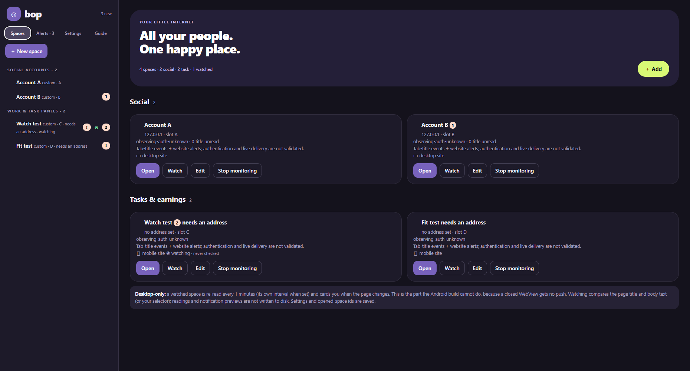
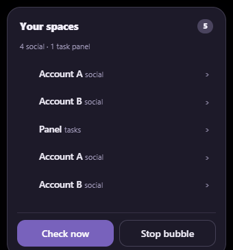
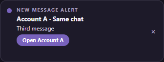
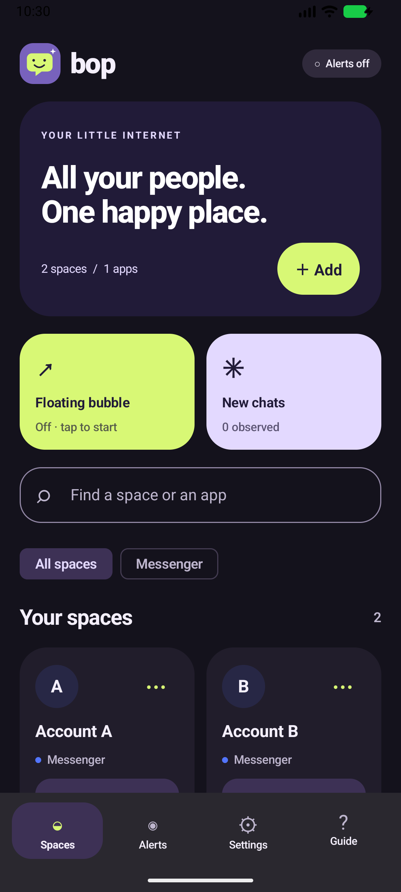
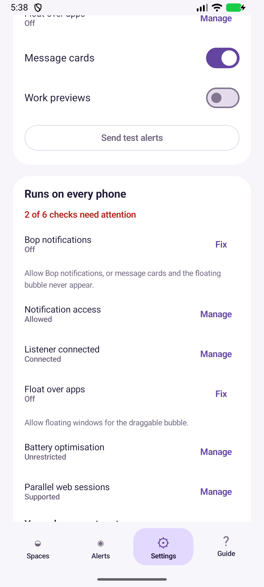
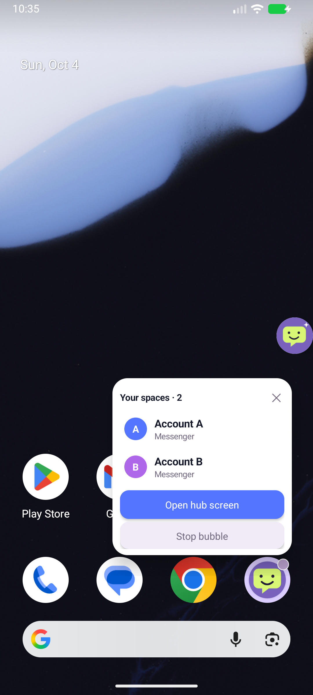

# Bop

**Many yous. One Bop.** An independent hub that keeps several messaging accounts apart on one device — a
Windows desktop app and an Android app, each giving every account its own separate browser session.

One window, four spaces, no logging out of anything: Messenger in A, Facebook in B, a paid-study board
watching itself in C, and a tray icon plus a small floating bubble telling you which one moved.





Bop was previously called TwoAccMess. Application IDs and the existing browser profile directories are
unchanged, so upgrading does not deliberately reset your logins.

## Download and run

| | File | Notes |
| --- | --- | --- |
| **Desktop — Windows 10/11 x64 (portable)** | [`Bop-0.2.7-portable.exe`](desktop/dist/Bop-0.2.7-portable.exe) | One self-contained file. No installer, nothing added to Program Files. Your spaces and logins live in `%APPDATA%\Bop` and survive an upgrade. |
| **Desktop — Windows 10/11 x64 (installer)** | [`Bop-0.2.7-setup.exe`](desktop/dist/Bop-0.2.7-setup.exe) | Per-user installer. Choose this one if you start Bop often. Uninstall from Settings → Apps. |
| **Android — 7.0 (API 24) or newer** | [`app-debug.apk`](app/build/outputs/apk/debug/app-debug.apk) · [`app-release-unsigned.apk`](app/build/outputs/apk/release/app-release-unsigned.apk) | Debug APK is installable for testing. Release APK is **unsigned**: sign it with your own key before installing it or handing it to anyone. |

**First launch on Windows will warn you.** Neither file is code-signed, so SmartScreen shows *“Windows
protected your PC”* — choose **More info → Run anyway**, or sign the build with your own certificate. Bop
is an independent project; it is not affiliated with, endorsed by, or shipped by any of the services it can
sign into.

Check the download before you run it:

```bash
sha256sum Bop-0.2.7-portable.exe
sha256sum Bop-0.2.7-setup.exe
```

## The first five minutes (desktop)

1. **Launch the file.** The hub opens and the round bubble appears in the corner. Closing the hub hides it
   to the tray — it keeps listening. Quit is the only thing that stops it, from the tray menu.
2. **＋ New space → Social account** (a messaging account), **AI account** (ChatGPT, Claude or Gemini),
   or **Task / earning panel** (a work, study or survey board), then pick an app or *Any other site* and
   paste its address. One AI space is one login; add the same assistant twice for two accounts.
3. **Open the space once and sign in.** Each space has its own cookies, storage and cache, so two Facebook
   accounts never see each other. Leave it whenever you like: the space keeps running in the background
   pane, and clicking **Spaces / Alerts / Settings / Guide** switches section without closing it.
4. **Set up a watch on a task panel.** `Watch` on the card, optionally a CSS selector (`#jobs, .studies`)
   and a phrase such as `available`. The first reading is only a baseline; after that you get a card the
   moment the page really changes. Pages are read, never reloaded, so a chat you are in the middle of is
   left alone.
5. **Make the bubble yours.** Settings → *Floating bubble*: 48, 56, 64, 72 or 80 px, transparency, what a
   double-click does, **a picture of your own** (any PNG, JPEG, WebP, BMP, GIF or SVG), and whether it
   floats over full-screen apps. Press it anywhere and drag — it stays exactly where you let go.
6. **Settings → Startup, tray & background pages** keeps Bop running from sign-in, so it is already
   listening before the first message arrives, and sets **how many pages stay running at once** (3, 5, 8 or
   all of them — **three by default**, which measured 992–1004 MB across ten processes on this machine).
   The panes above that limit go to sleep instead of piling up: the space keeps its sign-in, its
   cookies and its place in the list, its card stays quiet only if its watch is off, and opening it again
   wakes it. A sleeping space is labelled *asleep* on its card rather than looking like one that was never
   opened, and choosing a bigger number in Settings wakes the pages it can now afford.



Android, briefly: add a space per account, grant notification access (Bop's own notification listener turns
the phone's notifications into Bop cards), and the floating bubble gets a badge per account. **Settings → Runs on every
phone** has six live checks with a repair button each, plus the auto-start steps for the phone brands that
kill background apps.

**Messenger and Instagram start on the desktop layout on Android, on purpose.** Their phone web layouts have
no usable messages view inside an embedded browser: measured on 12 November 2026, a phone user agent is
redirected away from `www.facebook.com/messages/` to the retired `m.facebook.com` route, and Instagram's phone
web build hands off to the phone app instead of showing the direct inbox. The desktop layout is where the chat
list exists, so it is the default for those two spaces; **Options → Use mobile website** switches any space
back, the choice is remembered per space, and **Fit the page to this screen** rescues a wide dialog that
overflows. Signing in can still be refused by the provider inside an embedded browser — the app says so and
offers **Open Messenger app** and **Open outside Bop** rather than pretending it worked.





## What Bop is, and what it is not

Read this part before installing. Everything below is measured, not promised.

- **Bop is a notification assistant, not a replacement client.** It shows you that something happened and
  lets you open the real conversation. It does not host a chat UI of its own.
- **Bop cannot recover a notification that was never posted.** If Android or the source app decides not to
  notify — a muted chat, an already-open chat, a session Android suspended — there is nothing to observe
  through notification access. The Android Guide says so in the app, on purpose.
- **An unread marker is a count, not a message.** A tab title or a badge is an aggregate: a dot marker or
  an unchanged count cannot say *which* message is new. Cards are partial, never a full inbox.
- **Background delivery is best effort on both platforms.** Desktop keeps loaded spaces alive while it is
  hidden in the tray. Android may suspend or kill an off-screen web session, and cannot push for a web
  session at all. Doze suspends timers. No amount of storage or settings changes that.
- **No account details ever leave the device.** There is no Bop server, no Bop account, no analytics.

## Two apps, two jobs

They share the design language, the space identity rules (`A..Z, AA..`, no fixed ceiling) and the bubble
geometry, and nothing else.

| | Android — [`app/`](app) | Desktop — [`desktop/`](desktop) |
| --- | --- | --- |
| Job | Phone notifications + parallel web logins | Parallel web logins + **watching work/task panels** |
| Space kinds | Social accounts and AI accounts | `social`, `ai` (ChatGPT, Claude, Gemini) **and** `tasks` (user-testing and earning panels) |
| How it learns about a page | Installed-app notifications + native WebView title events (off-screen best effort) | Native tab-title events + website alerts; opt-in task page checks |
| Bubble | Always-on-top overlay window | Floating window with size, transparency, double-click action and a saved spot |
| Catalog | 22 services with an HTTPS host allowlist: Messenger, Facebook, Instagram, WhatsApp, TikTok, Telegram, Zalo, X, Threads, Reddit, Discord, Snapchat, LinkedIn, Viber, Skype, Google Chat, VK, Bluesky, WeChat, ChatGPT, Claude, Gemini | any site you paste, one host per space, plus explicit one-time sign-in grants |

They are deliberately different, not a port. A phone that re-read a study board would burn battery for
something the notification listener already covers; a desktop that only mirrored phone notifications would
miss the one thing that matters there — a test that opens and fills while you are in another window. The
Android app is unaffected by the desktop one and gains none of its task features. A catalog entry is not a
promise that a service still supports WebView login or chat.

## Privacy

- **Nothing leaves the device.** No account, no telemetry, no crash reporting, no Bop server to call.
- **Settings are encrypted** with the operating system's own key store when one is available; Settings →
  Diagnostics says plainly when it is not.
- **Cookies and logins** stay in each space's own Chromium profile. *Clear* removes cookies, site storage
  and cache for one space only — the others stay signed in. **Hide** removes a space from the list but
  keeps its local login and its picture; **Delete** removes the space and erases its Chromium profile too.
  A task panel's sign-in that continues on another domain asks once for that one host, per space, and the
  grant is listed and revocable in Edit.
- **What Bop reads from a page:** the tab title (an unread marker) and, for a space you asked to watch,
  the page's own text so it can tell you it changed. No message bodies, senders or credentials are
  extracted, and notification previews are not written to disk. Alerts live in memory and are gone when
  Bop closes.
- **Screenshots and screen recording can expose whatever is on screen** — that is the operating system's
  behaviour, not something Bop adds or hides.

## What is verified, and what is not

Every number below was produced against the files in this repository, and the raw output is linked. The
full history lives in [docs/desktop.md](docs/desktop.md) and [docs/verification.md](docs/verification.md).

| Check | Result | Evidence |
| --- | --- | --- |
| Android — Messenger and Instagram reach a messages view again (12 Nov) | A phone user agent is redirected off `www.facebook.com/messages/` to the legacy `m.facebook.com` route, which answers `login.php?…&refsrc=deprecated`; the desktop agent is not redirected. Both apps now start on the desktop layout, the layout migration can no longer discard a switch the owner flipped, and the oldest per-activity switch carries its value across | [reliability-2026-11.md](docs/reliability-2026-11.md) |
| Android JVM tests (12 Nov) | **146 passed**, 0 failed / errors / skipped | `./gradlew :app:testDebugUnitTest` |
| Android debug build + lint (12 Nov) | APK built (11 748 101 bytes), lint **0 errors**, 51 pre-existing warnings | `./gradlew :app:assembleDebug :app:lintDebug` |
| Desktop unit tests (12 Nov) | **136 passed**, 0 failed | `cd desktop && npm test` |
| Desktop integration harness, real Electron (12 Nov) | **21/21 checks, exit 0**, no extra flags: isolated sessions, tray/minimized delivery, title+notification pairing, sign-in card raised once and cleared, crash backoff, reconnect, mute, split note stores, stop releasing every view | [monitor-smoke.json](docs/evidence/reliability-2026-11/monitor-smoke.json) |
| Desktop unit tests | **136 passed**, 0 failed (23 Oct) | `cd desktop && npm test` |
| Desktop integration, real Electron, 3 accounts (23 Oct) | **ok: true**, 10/10 steps: isolated same-origin sessions, minimized/tray, a sign-in route raising exactly one card for its own account and clearing on recovery, renderer crash with the real 30 s backoff, offline/online, mute, split note stores, stop releasing every view. 19 OS notification requests, 0 failed | [monitor-smoke.json](docs/evidence/major-update/monitor-smoke.json) |
| Desktop background cost (23 Oct) | one save of a full note collection: **27.04 ms → 0.36 ms**, **5,334,711 → 285 bytes** written; a message event now rewrites **0** note bytes | [perf-notes.json](docs/evidence/major-update/perf-notes.json), `npx electron tools/perf-notes.js` |
| Desktop retry ladder, end to end (23 Oct) | **ok: true**: six real failed navigations at the production 30/60/120/240/480 s backoff, "stopped being monitored" at **930.9 s** with one card and one OS notification, and a working load clears it silently | [retry-smoke.json](docs/evidence/major-update/retry-smoke.json), `npx electron . --bop-retry-smoke` |
| Android JVM tests (23 Oct) | **142 passed**, 0 failed, including listener-reconnect isolation | `./gradlew :app:testDebugUnitTest` |
| Android on an emulator (23 Oct, Android 17 / API 37) | 10 checks, 0 failed: a real `MessagingStyle` notification from a bound slot became one card, a dismissal survived a listener revoke/re-grant, forced deep idle still ingested a message, `am kill` and a full reboot restored 3 spaces, and revoking then granting `POST_NOTIFICATIONS` now brings the pending alert back (it did not before) | [android-device.json](docs/evidence/major-update/android-device.json), fixture in [tools/notifier-fixture](tools/notifier-fixture) |
| CI (23 Oct) | added [`.github/workflows/ci.yml`](.github/workflows/ci.yml): desktop `npm ci` + syntax + `npm test` on Windows, Android `testDebugUnitTest` + `assembleDebug` on Linux. The same commands pass locally; GitHub has not run it yet | `.github/workflows/ci.yml` |
| Desktop functional smoke, real Electron (23 Oct) | **ok: true**, 51 steps: window/tray, panes, dialogs above panes, theme, reminder card, bubble drag by real gesture, both accounts notifying while the hub is hidden, `[1,1]` same-origin sessions, sign-in grant, delete space, settings UI | [source-smoke.json](docs/evidence/major-update/source-smoke.json) |
| Desktop **source tree 0.2.1**, 48-step smoke | **ok: true**, 48 steps, `missingFiles: []` | [source-smoke-022.json](docs/evidence/desktop-portable/source-smoke-022.json) |
| Desktop **source tree 0.2.1**, 19-step live check | **19/19**, 0 failed | [live-check-022.json](docs/evidence/desktop-portable/live-check-022.json) |
| Desktop **portable EXE 0.2.1**, 19-step live check on the delivered file | **19/19**, 0 failed, including the real-pointer drag: +220,+130 → +220,+130, **offBy 0**, spot persisted | [live-check-022-exe.json](docs/evidence/desktop-portable/live-check-022-exe.json) |
| Desktop **portable EXE 0.2.1**, 48-step smoke run by the EXE itself | **ok: true**, 48 steps, 4 alerts, `packaged: true`, `missingFiles: []` | [packaged-smoke-022.json](docs/evidence/desktop-portable/packaged-smoke-022.json) |
| 0.2.1 startup: the hub is loaded before any page is fetched, 4 remembered spaces | app's own clock: hub document loaded **520 ms** after the process started (source tree) and **1236 ms** on the portable EXE, where the launcher unpacks first; the first page is fetched **420 ms** / **419 ms** after that, one at a time: +420/+823/+1214 ms (spread 794 ms) source, +419/+1195 ms EXE | [live-check-022.json](docs/evidence/desktop-portable/live-check-022.json), [live-check-022-exe.json](docs/evidence/desktop-portable/live-check-022-exe.json) |
| 0.2.1 **default page budget is three pages** | a fresh profile with four remembered spaces keeps three and sleeps the oldest with no setting touched (`budget: 3`, `waking: [D,C,B]`, `asleep: [A]`), and every page the launch fetched is one of the three it said it would fetch | [live-check-022.json](docs/evidence/desktop-portable/live-check-022.json), [live-check-022-exe.json](docs/evidence/desktop-portable/live-check-022-exe.json) |
| 0.2.1 live-page budget on the running app | limit 3 → 1 page asleep, one renderer gone; asking for 5 through the settings IPC fetched its page again (4 live, 11 processes); back at 3, waking a space by opening it put another to sleep instead, 3 live pages again | [live-check-022.json](docs/evidence/desktop-portable/live-check-022.json) |
| 0.2.1 RAM, measured inside those runs | 4 live pages **1094 MB / 11 processes** → 3 live pages **1002–1015 MB / 10 processes** (source tree), **1039 → 952–962 MB** (portable EXE): one sleeping page returns about **90 MB** and one process | [live-check-022.json](docs/evidence/desktop-portable/live-check-022.json), [live-check-022-exe.json](docs/evidence/desktop-portable/live-check-022-exe.json) |
| 0.2.1 **hub minimized and brought back** (15 Oct, same session) | the window the reported bug left minimized (`160x28` at `-32000,-32000` while actually minimized) now comes back whole: `showDashboard` restores before it shows, `layout()` refuses to size panes from a minimized window, and every transition back into a visible window re-applies the open pane's bounds and repaints it. Measured with the open pane's own viewport across the whole cycle: **944×781 before → 944×781 while minimized → 944×781 after**, `minimized: false, visible: true` — source tree and the packaged EXE alike | [source-smoke-022.json](docs/evidence/desktop-portable/source-smoke-022.json), [packaged-smoke-022.json](docs/evidence/desktop-portable/packaged-smoke-022.json) |
| 0.2.1 **only a real arrival rings** (15 Oct, same session) | three rules, each unit-tested: a route change inside a page re-renders its badge against the account's own state, so the next title reading is a baseline rather than four messages (`navigate()`); a bare dot or bullet cannot say *how many*, so one space rings on a marker at most once a minute while a number that grew always rings; and a title rise and the page's own notification for the same message are one arrival within 2.5 s instead of two cards. The bubble's panel now also lists every account with **that page's own unread count**, the last thing it really said, and what it is doing (listening, asleep, needs sign-in, unreachable) | `cd desktop && npm test` (104 passed) |
| 0.2.1 **the bubble's panel follows the accounts while it is open** (15 Oct, same session) | with the panel open, acknowledging one account's cards from the dashboard cleared that row's badge without the panel being closed and reopened: `Live board — Other site · reading this page · watching — Live board changed — 1`, then the same row with no badge. Asserted by the 19-step live check on the source tree **and** on the delivered EXE | [live-check-022.json](docs/evidence/desktop-portable/live-check-022.json), [live-check-022-exe.json](docs/evidence/desktop-portable/live-check-022-exe.json) |
| 0.2.1 launch time | portable file **10.6–31.0 s** to a usable hub over five launches (four of them 22.7–31.0 s: the launcher unpacks 190 MB into `%TEMP%` first, every time), installed copy **1.1–1.5 s** | [`desktop/tools/startup-check.ps1`](desktop/tools/startup-check.ps1) on this machine |
| 0.2.1 payload trim (English-only locale packs) | download 85 221 386 → **77 995 196 bytes** (portable) and 85 759 684 → **78 224 122 bytes** (installer), unpacked payload 213 → **190 MB**; launch time unchanged (the ranges overlap), so this buys download and disk, not speed | build logs above |
| 0.2.1 rebuilt with the verification-profile fix (15 Oct) | same features, same version; a `--bop-smoke` run from the shipped EXE now keeps its own profile — verified on the delivered file: 47-step smoke `ok` with the real `%APPDATA%\Bop\bop-settings.bin` **byte-identical** before and after | [packaged-smoke-021.json](docs/evidence/desktop-portable/packaged-smoke-021.json) |
| 0.2.1 rebuilt with the startup-ordering fixes (15 Oct, same session) | Three ways a page could be fetched too early, each found by running the delivered EXE rather than the source tree, where a fast hub hides them: (1) a snapshot "is the hub up yet?" answered yes ~200 ms early, because `loadFile` sets the URL synchronously while Chromium has not yet reported a load in progress — the first page was fetched **207 ms** after the hub mark; (2) the watcher's own one-second timer read a watched space by loading its page **1311 ms before** the hub document had loaded; (3) that same timer, landing just after the hub, fetched a page **237 ms** after it. Now the hub's own load handler releases both background fetchers and they keep one shared settle window (`HUB_SETTLE_MS`), so the hold is true by construction. Verified on the delivered file: 18/18 live check on the portable EXE **and** on the source tree (420 / 410 ms; the source run's hub happened to take 1508 ms that time, which is the slow case that exposed (3)), 47-step smoke `ok`, profile byte-identical | [live-check-021-exe.json](docs/evidence/desktop-portable/live-check-021-exe.json), [live-check-021.json](docs/evidence/desktop-portable/live-check-021.json), [packaged-smoke-021.json](docs/evidence/desktop-portable/packaged-smoke-021.json) |
| Desktop **packaged 0.1.9**, 45-step smoke from the portable EXE | **ok: true**, 45 steps, `missingFiles: []` | [packaged-smoke-019.json](docs/evidence/desktop-portable/packaged-smoke-019.json) |
| Desktop **portable EXE 0.1.9**, 15-step live check | **15/15**, 0 failed | [live-check-019.json](docs/evidence/desktop-portable/live-check-019.json) |
| Real OS-pointer drag of the bubble | +220,+130 → moved +220,+130, **offBy 0** | [release-019.txt](docs/evidence/desktop-portable/release-019.txt) |
| Both APKs searched for Vietnamese, `aapt2 dump configurations` | no Vietnamese string, **no locale configuration at all** | [release-019.txt](docs/evidence/desktop-portable/release-019.txt) |
| Android JVM unit tests | **124 passed**, 0 failed / skipped | `./gradlew :app:testDebugUnitTest` |
| Theme contrast audit, six surfaces × dark/light | **0 elements below 4.5:1** | [ui-017.txt](docs/evidence/desktop-portable/ui-017.txt) |
| Android device tests on an API 37 emulator | 8 passed, 0 failed | [docs/verification.md](docs/verification.md) |

**The real-pointer drag needed a second look, and got one.** It failed in five earlier 0.2.1 runs on this
machine, each time with the same reading — the window did not move at all across three injected gestures —
and the receiver was not captured then. The same file passes that step today, twice, source tree and EXE, so
those readings were the machine's and not the file's. What is measured about that class of failure: with two
Bop copies holding the same 64px spot the machine handed a +120,+90 drag to exactly one of them and the
other read exactly that zero
([bubble-spot-contention-021.json](docs/evidence/desktop-portable/bubble-spot-contention-021.json)); a copy
this run did not start is now named before the drag runs (see `ok other-bops` in
[live-check-021-other-copy.json](docs/evidence/desktop-portable/live-check-021-other-copy.json)); and a drag
that does not move reports the class, title, rectangle, PID and process of the window that owns the point
along with a picture of the desktop ([`desktop/tools/window-at.ps1`](desktop/tools/window-at.ps1)). A leftover
copy is what an interrupted run leaves behind: killing a portable EXE's launcher does not stop the unpacked
app, which is why the check now kills its own app by DevTools port — through
[`desktop/tools/bop-processes.ps1`](desktop/tools/bop-processes.ps1) — and reports `cleanup` in its result.

**Not verified anywhere, and not claimed:** a real signed-in service account in either app, real incoming
provider messages, per-service DOM selectors (every space is still driven by the tab title, which cannot
tell a muted chat from an active one), screen-off or Doze delivery on a real phone, OEM-specific
auto-start behaviour, audible sound, and multi-monitor or scaled-display dragging. The desktop and Android
artifacts are unsigned. Both desktop downloads are unsigned and neither is code-signed; the installer is
built from the same source as the portable file.

## Build from source

Needs Node.js and, for the Android app, a JDK and the Android SDK.

```bash
# Desktop (Electron) — Windows x64
cd desktop
npm install
npm test                                       # 136 unit tests
npm run smoke                                  # 47-step smoke against the source
npm run dist:portable                          # -> dist-portable-final/Bop-0.2.7-portable.exe, one file
npm run dist                                   # -> dist/Bop-0.2.7-portable.exe and Bop-0.2.7-setup.exe
npm run smoke:live:exe                         # 18-step live check against that EXE
```

```bash
# Android
export JAVA_HOME='/c/Program Files/Android/Android Studio/jbr'   # Git Bash / Android Studio JBR
./gradlew :app:assembleDebug :app:assembleRelease :app:testDebugUnitTest --console=plain
```

For release signing, copy [keystore.properties.example](keystore.properties.example) to the ignored
`keystore.properties` and fill in your upload-key settings. The release build publishes under
`com.twoaccmess.hub` by default; override `publishApplicationId` with your own reverse-domain ID before a
first store publication. The Android build ships **English only** on purpose
(`androidResources { localeFilters += listOf("en") }`), which also drops 130 KB of library translations.

## Repository layout

| Path | What is in it |
| --- | --- |
| [`desktop/`](desktop) | The Electron app: main process, renderer, its 136 unit tests and the check tools |
| [`app/`](app) | The Android app (Kotlin, Compose) |
| [`docs/`](docs) | Behaviour, limits and the verification log — including [PRIVACY.md](docs/PRIVACY.md) |
| [`docs/evidence/`](docs/evidence) | Raw output behind every claim: smoke reports, live-check reports, captures |
| [`experiments/`](experiments) | Standalone probes and lab rooms, none of them part of either app |
| [`tools/notifier-fixture/`](tools/notifier-fixture) | A standalone verification app that installs as `com.whatsapp` so the Android alert path can be exercised on an emulator without a real account. Not part of any release |
| [`assets/`](assets) | Icon and avatar |

## Documentation

- [Desktop behaviour, releases and limits](docs/desktop.md)
- [November 2026 reliability round: findings, fixes, evidence and limits](docs/reliability-2026-11.md)
- [October 2026 audit: findings, fixes, measurements and remaining limits](docs/major-update-audit.md)
- [What was verified, and what was not](docs/verification.md)
- [Privacy policy](docs/PRIVACY.md)
- [Monitoring mechanisms and measured limits](docs/monitoring.md)
- [The unread scan core](docs/scanning.md)
- [Setup and acceptance](docs/mvp-setup.md)
- [Launch and upload copy](docs/launch/README.md)
- Machine-readable release checks: [docs/desktop-release-verification.json](docs/desktop-release-verification.json)

## Licence

**No licence is granted by default.** Add one — and review the Play Store / SmartScreen requirements,
signing and policy notes above — before publishing or sharing a build.
