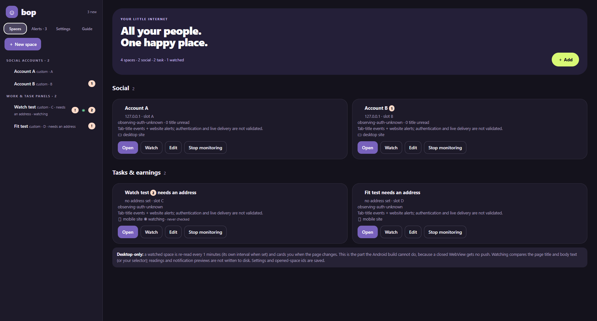
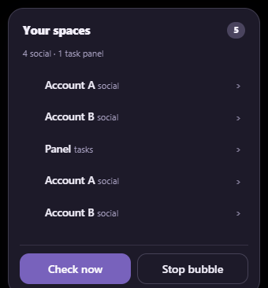
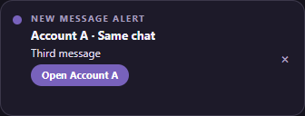
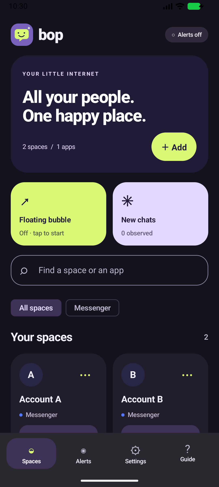
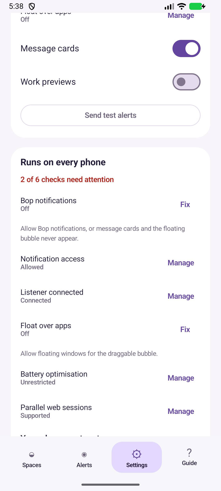
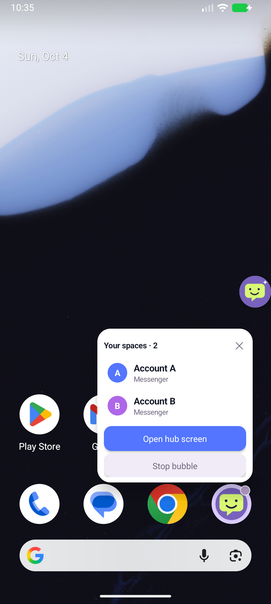

# Bop

**Many yous. One Bop.** An independent hub that keeps several messaging accounts apart on one device — a
Windows desktop app and an Android app, each giving every account its own separate browser session.

One window, four spaces, no logging out of anything: Messenger in A, Facebook in B, a paid-study board
watching itself in C, and a tray icon plus a small floating bubble telling you which one moved.





Bop was previously called TwoAccMess. Application IDs and the existing browser profile directories are
unchanged, so upgrading does not deliberately reset your logins.

## Download and run

| | File | Notes |
| --- | --- | --- |
| **Desktop — Windows 10/11 x64** | [`Bop-0.2.0-portable.exe`](desktop/dist-portable-final/Bop-0.2.0-portable.exe) · 85 221 386 bytes · sha256 `6d4533bbe7fd5efe8aa8503d34019cafa6246379c1044fd55ddb56eef7c437c6` | One self-contained file. No installer, nothing added to Program Files, delete the file to remove it. Your spaces and logins live in `%APPDATA%\Bop` and survive an upgrade. |
| **Android — 7.0 (API 24) or newer** | built from source: [`app-debug.apk`](app/build/outputs/apk/debug/app-debug.apk) · [`app-release-unsigned.apk`](app/build/outputs/apk/release/app-release-unsigned.apk) | The release APK is **unsigned**: sign it with your own key before installing it on a phone or handing it to anyone. |

**First launch on Windows will warn you.** Neither file is code-signed, so SmartScreen shows *“Windows
protected your PC”* — choose **More info → Run anyway**, or sign the build with your own certificate. Bop
is an independent project; it is not affiliated with, endorsed by, or shipped by any of the services it can
sign into.

Check the download before you run it:

```bash
sha256sum Bop-0.2.0-portable.exe
# 6d4533bbe7fd5efe8aa8503d34019cafa6246379c1044fd55ddb56eef7c437c6
```

## The first five minutes (desktop)

1. **Launch the file.** The hub opens and the round bubble appears in the corner. Closing the hub hides it
   to the tray — it keeps listening. Quit is the only thing that stops it, from the tray menu.
2. **＋ New space → Social account** (a messaging account) or **Task / earning panel** (a work, study or
   survey board), then pick an app or *Any other site* and paste its address.
3. **Open the space once and sign in.** Each space has its own cookies, storage and cache, so two Facebook
   accounts never see each other. Leave it whenever you like: the space keeps running in the background
   pane, and clicking **Spaces / Alerts / Settings / Guide** switches section without closing it.
4. **Set up a watch on a task panel.** `Watch` on the card, optionally a CSS selector (`#jobs, .studies`)
   and a phrase such as `available`. The first reading is only a baseline; after that you get a card the
   moment the page really changes. Pages are read, never reloaded, so a chat you are in the middle of is
   left alone.
5. **Make the bubble yours.** Settings → *Floating bubble*: 48, 56, 64, 72 or 80 px, transparency, what a
   double-click does, **a picture of your own** (any PNG, JPEG, WebP, BMP, GIF or SVG), and whether it
   floats over full-screen apps. Press it anywhere and drag — it stays exactly where you let go.
6. **Settings → Startup, tray & background pages** keeps Bop running from sign-in, so it is already
   listening before the first message arrives.



Android, briefly: add a space per account, grant notification access (Bop's own notification listener turns
the phone's notifications into Bop cards), and the floating bubble gets a badge per account. **Settings → Runs on every
phone** has six live checks with a repair button each, plus the auto-start steps for the phone brands that
kill background apps.





## What Bop is, and what it is not

Read this part before installing. Everything below is measured, not promised.

- **Bop is a notification assistant, not a replacement client.** It shows you that something happened and
  lets you open the real conversation. It does not host a chat UI of its own.
- **Bop cannot recover a notification that was never posted.** If Android or the source app decides not to
  notify — a muted chat, an already-open chat, a session Android suspended — there is nothing to observe
  through notification access. The Android Guide says so in the app, on purpose.
- **An unread marker is a count, not a message.** A tab title or a badge is an aggregate: a dot marker or
  an unchanged count cannot say *which* message is new. Cards are partial, never a full inbox.
- **Background delivery is best effort on both platforms.** Desktop keeps loaded spaces alive while it is
  hidden in the tray. Android may suspend or kill an off-screen web session, and cannot push for a web
  session at all. Doze suspends timers. No amount of storage or settings changes that.
- **No account details ever leave the device.** There is no Bop server, no Bop account, no analytics.

## Two apps, two jobs

They share the design language, the space identity rules (`A..Z, AA..`, no fixed ceiling) and the bubble
geometry, and nothing else.

| | Android — [`app/`](app) | Desktop — [`desktop/`](desktop) |
| --- | --- | --- |
| Job | Phone notifications + parallel web logins | Parallel web logins + **watching work/task panels** |
| Space kinds | Social accounts | `social` **and** `tasks` (user-testing and earning panels) |
| How it learns about a page | Installed-app notifications + native WebView title events (off-screen best effort) | Native tab-title events + website alerts; opt-in task page checks |
| Bubble | Always-on-top overlay window | Floating window with size, transparency, double-click action and a saved spot |
| Catalog | 19 services with an HTTPS host allowlist: Messenger, Facebook, Instagram, WhatsApp, TikTok, Telegram, Zalo, X, Threads, Reddit, Discord, Snapchat, LinkedIn, Viber, Skype, Google Chat, VK, Bluesky, WeChat | any site you paste, one host per space |

They are deliberately different, not a port. A phone that re-read a study board would burn battery for
something the notification listener already covers; a desktop that only mirrored phone notifications would
miss the one thing that matters there — a test that opens and fills while you are in another window. The
Android app is unaffected by the desktop one and gains none of its task features. A catalog entry is not a
promise that a service still supports WebView login or chat.

## Privacy

- **Nothing leaves the device.** No account, no telemetry, no crash reporting, no Bop server to call.
- **Settings are encrypted** with the operating system's own key store when one is available; Settings →
  Diagnostics says plainly when it is not.
- **Cookies and logins** stay in each space's own Chromium profile. *Clear* removes cookies, site storage
  and cache for one space only — the others stay signed in. Removing a space hides it and clears its hub
  alerts but keeps its local login and its picture.
- **What Bop reads from a page:** the tab title (an unread marker) and, for a space you asked to watch,
  the page's own text so it can tell you it changed. No message bodies, senders or credentials are
  extracted, and notification previews are not written to disk. Alerts live in memory and are gone when
  Bop closes.
- **Screenshots and screen recording can expose whatever is on screen** — that is the operating system's
  behaviour, not something Bop adds or hides.

## What is verified, and what is not

Every number below was produced against the files in this repository, and the raw output is linked. The
full history lives in [docs/desktop.md](docs/desktop.md) and [docs/verification.md](docs/verification.md).

| Check | Result | Evidence |
| --- | --- | --- |
| Desktop unit tests | **86 passed**, 0 failed | `cd desktop && npm test` |
| Desktop **packaged 0.1.9**, 45-step smoke from the portable EXE | **ok: true**, 45 steps, `missingFiles: []` | [packaged-smoke-019.json](docs/evidence/desktop-portable/packaged-smoke-019.json) |
| Desktop **portable EXE 0.1.9**, 15-step live check | **15/15**, 0 failed | [live-check-019.json](docs/evidence/desktop-portable/live-check-019.json) |
| Real OS-pointer drag of the bubble | +220,+130 → moved +220,+130, **offBy 0** | [release-019.txt](docs/evidence/desktop-portable/release-019.txt) |
| Both APKs searched for Vietnamese, `aapt2 dump configurations` | no Vietnamese string, **no locale configuration at all** | [release-019.txt](docs/evidence/desktop-portable/release-019.txt) |
| Android JVM unit tests | **124 passed**, 0 failed / skipped | `./gradlew :app:testDebugUnitTest` |
| Theme contrast audit, six surfaces × dark/light | **0 elements below 4.5:1** | [ui-017.txt](docs/evidence/desktop-portable/ui-017.txt) |
| Android device tests on an API 37 emulator | 8 passed, 0 failed | [docs/verification.md](docs/verification.md) |

**Not verified anywhere, and not claimed:** a real signed-in service account in either app, real incoming
provider messages, per-service DOM selectors (every space is still driven by the tab title, which cannot
tell a muted chat from an active one), screen-off or Doze delivery on a real phone, OEM-specific
auto-start behaviour, audible sound, and multi-monitor or scaled-display dragging. The desktop and Android
artifacts are unsigned. There is no installer target in this build.

## Build from source

Needs Node.js and, for the Android app, a JDK and the Android SDK.

```bash
# Desktop (Electron) — Windows x64
cd desktop
npm install
npm test                                       # 95 unit tests
npm run smoke                                  # 45-step smoke against the source
npm run dist:portable                          # -> dist-portable-final/Bop-0.2.0-portable.exe, one file
npm run smoke:live:exe                         # 16-step live check against that EXE
```

```bash
# Android
export JAVA_HOME='/c/Program Files/Android/Android Studio/jbr'   # Git Bash / Android Studio JBR
./gradlew :app:assembleDebug :app:assembleRelease :app:testDebugUnitTest --console=plain
```

For release signing, copy [keystore.properties.example](keystore.properties.example) to the ignored
`keystore.properties` and fill in your upload-key settings. The release build publishes under
`com.twoaccmess.hub` by default; override `publishApplicationId` with your own reverse-domain ID before a
first store publication. The Android build ships **English only** on purpose
(`androidResources { localeFilters += listOf("en") }`), which also drops 130 KB of library translations.

## Repository layout

| Path | What is in it |
| --- | --- |
| [`desktop/`](desktop) | The Electron app: main process, renderer, its 86 unit tests and the check tools |
| [`app/`](app) | The Android app (Kotlin, Compose) |
| [`docs/`](docs) | Behaviour, limits and the verification log — including [PRIVACY.md](docs/PRIVACY.md) |
| [`docs/evidence/`](docs/evidence) | Raw output behind every claim: smoke reports, live-check reports, captures |
| [`experiments/`](experiments) | Standalone probes and lab rooms, none of them part of either app |
| [`assets/`](assets) | Icon and avatar |

## Documentation

- [Desktop behaviour, releases and limits](docs/desktop.md)
- [What was verified, and what was not](docs/verification.md)
- [Privacy policy](docs/PRIVACY.md)
- [Monitoring mechanisms and measured limits](docs/monitoring.md)
- [The unread scan core](docs/scanning.md)
- [Setup and acceptance](docs/mvp-setup.md)
- Machine-readable release checks: [docs/desktop-release-verification.json](docs/desktop-release-verification.json)

## Licence

**No licence is granted by default.** Add one — and review the Play Store / SmartScreen requirements,
signing and policy notes above — before publishing or sharing a build.
